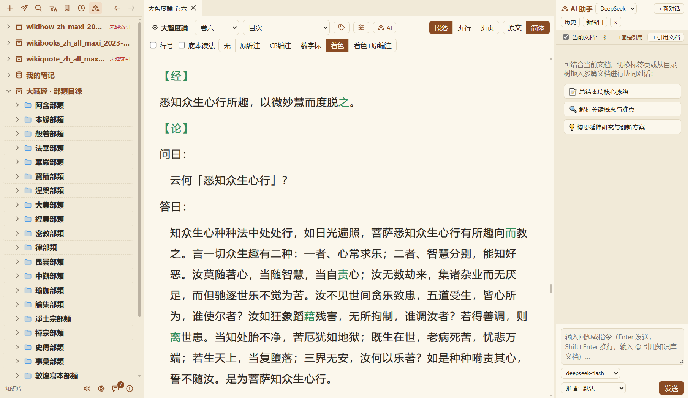
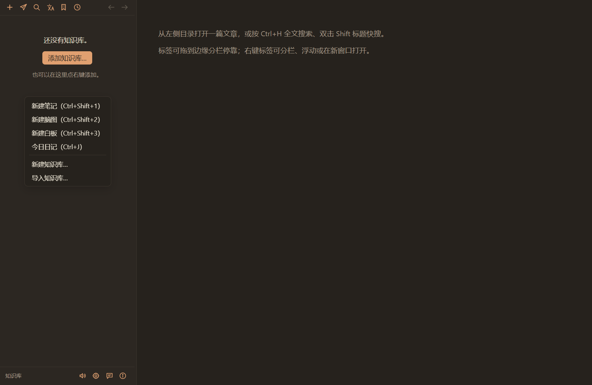

# Smart Library

**把大量资料放在本地，随时搜索、阅读和整理。**

Smart Library 是一款面向个人的跨平台本地知识库桌面软件，将资料管理、全文检索、阅读和笔记放在同一个工作区。

资料越积越多，难的往往不只是保存，而是需要时还能找到、找到后能接着读、读过后能留下自己的理解。Smart Library 从这些需求出发，着重改善大量文本资料的管理与检索体验，让本机文件、个人笔记和离线资料包都能成为日常可用的知识库。

你可以从一个文件夹或几篇笔记开始，也可以接入整套文集、离线百科或专题资料库，在同一个界面里查找、对照阅读和记录。

**知识库分别管理，搜索默认跨库。** 标题快搜默认查找所有已绑定知识库，全文搜索默认覆盖所有已建立索引的知识库（结果按知识库分标签页展示）；需要时再限定到某个库、目录或文档。

[下载安装](https://github.com/Yuanuo/smart-library/releases) · [快速上手](#快速上手) · [反馈问题与建议](https://github.com/Yuanuo/smart-library/issues)

## 界面

| 阅读：经文、校注与多标签工作区（浅色） | 开始：还没有知识库时（深色） |
| :---: | :---: |
|  |  |

左侧目录树按知识库分组，中间是多标签阅读区，右侧可以展开 AI 助手。主题跟随系统，也可以固定为浅色或深色。

## 为什么做 Smart Library

很多知识库工具擅长写笔记、连接想法，但当资料增长到整套文集或大量离线文章时，导入、浏览和全文搜索的体验未必跟得上。另一方面，离线资料包虽然内容丰富，阅读、检索和笔记却常常分散在不同工具中。

Smart Library 希望把这几件事衔接起来：

- **资料多了，仍然方便查找。** 将全文检索作为核心能力，支持跨知识库搜索、限定范围、筛选和原文定位。
- **找到内容，直接进入阅读。** 在搜索结果中查看上下文，再跳到原文，配合分栏和多窗口对照资料。
- **阅读所得，留在自己的知识库。** 把摘录、笔记、日记、脑图和白板放进同一套整理与检索流程。
- **数据由自己保存。** 本地管理资料、笔记和索引，日常阅读与搜索可离线使用。

## 主要功能

### 搜索：从标题到全文，从结果回到原文

- **默认跨库全文搜索**：在同一列表展示各库的命中并标出来源。按知识库查看该库的属性筛选，点击高亮片段可跳转到原文。
- **宽松匹配与精确短语**：既可以用多个关键词组合查找，也可以按连续短语检索。宽松匹配不要求各匹配片段相邻。
- **中文检索适配**：支持繁简互查、全半角归一化及部分异体字归一化，减少文字形式差异带来的遗漏。
- **共用搜索范围**：同一搜索页可收集不同库的目录和文档，自动合并重复或被父节点覆盖的条目。各库使用属于自己的范围。
- **默认跨库标题快搜**：在所有已绑定知识库中快速查找并打开文档、文章或目录，也可切换到指定知识库；支持别名与拼音首字母查找。
- **多个搜索页**：保留不同的搜索条件，与阅读页一起分栏或放进独立窗口。

### 阅读：让检索与整理连贯起来

- 多标签、分栏、浮动面板与独立窗口，方便同时阅读多份资料。
- 保存阅读位置，恢复工作区中的标签和阅读进度。
- 页内查找、书签、收藏、标签和最近访问，方便回到读过的内容。
- 选中文字后，可以继续检索、查词、加入笔记或发送到今日记；摘录保留来源链接，便于回看原文。
- 可调整阅读字体、字号、行距与明暗主题。

### 笔记：文字、脑图与白板

- **Markdown 笔记**：支持排版编辑与源码编辑、图片附件和自动保存。
- **思维导图**：用树状结构梳理内容，支持导出 HTML、XMind 和 Markdown 大纲。
- **手绘白板**：自由绘图，整理关系与思路。
- **日记**：按年、月、日组织，阅读中的选文可以直接追加到今日记。
- **文档快照**：保存、查看和还原文档的历史版本。
- **分享、备份与迁移**：将自己制作的知识库导出为 `.smartlib` 包，分享给其他人导入使用，也可用于个人备份或迁移到另一台电脑。包内包含 Markdown 文档及相应资源。

### 辅助工具

- **本地词典**：添加 AppXI `.words` 词典，在阅读中选词查询，也可在独立窗口查看释义。设置里还能导入常见的旧词典格式：TXT（`【词条】词义`）、StarDict（`.ifo`/`.idx`/`.dict`）和 MDict（`.mdx`/`.mdd`），导入时转换成 `.words`，自动补简体、繁体和小写变体，MDD 里的图片会一起带上。
- **拼音工具**：中文转拼音，支持自定义拼音词典。
- **可选 AI 助手**：配置 OpenAI 兼容或 Anthropic 接口后，结合当前文档、选文或引用的多篇资料进行对话，将回复保存或用于编辑笔记、脑图和白板。支持多个模型配置、会话历史与独立对话窗口。

AI 助手默认关闭。启用后，参与对话的内容会发送到你配置的模型服务；本地阅读、搜索和笔记不依赖 AI 服务。

## 支持哪些资料

| 来源 | 使用方式 |
| --- | --- |
| **本地文件夹** | 直接绑定已有资料目录，读取和检索 TXT、Markdown、HTML，以及 PDF、DOCX、PPTX、ODT 中可提取的文本。默认只读，也可开启读写模式，编辑 Markdown 笔记、脑图和白板。 |
| **内部知识库** | 在程序内创建和组织个人笔记，支持多级结构、脑图、白板与日记，可导出知识库包供他人导入使用，或留作备份。 |
| **ZIM 离线资料包** | 接入维基百科、维基教科书、维基语录等来源的兼容数据包，进行标题快搜、全文检索和文章阅读，支持包内文章链接及章节跳转。 |
| **CBETA 数据包** | 绑定 `bookcase.zip` 或解压目录，支持目录浏览、全文检索、结构化阅读和引用定位。 |

### ZIM 与 CBETA 的阅读支持

除了个人文件和笔记，Smart Library 也关注大型离线资料包的使用体验：让包中的文章进入统一的阅读与搜索工作区，并能随手摘录和整理。

**ZIM**：目前支持 ZIM 5.0 的未压缩及 Zstandard 压缩数据包，已使用中文维基教科书和维基语录数据包验证读取与全文索引。文章以标题快搜和全文搜索为主要入口，不展开为完整目录树。维基文章之间的链接可优先查找已绑定的对应离线知识库。

**CBETA**：提供结构化经文阅读、校注异文对照、底本读法切换、经内目次与引用定位，并与跨库检索、分栏阅读和摘录笔记衔接。详见 [CBETA 数据支持与功能说明](docs/CBETA.MD)。

这些资料源与本地文件、个人笔记共用管理和检索界面。日常使用可以只绑定自己的文件夹，也可以按需要添加离线资料包。

## 下载与安装

Smart Library 面向 **Windows、macOS 与 Linux**。前往 [GitHub Releases](https://github.com/Yuanuo/smart-library/releases) 选择适合自己系统的安装包，按对应版本的说明安装。

Windows 需要 **Windows 10（1803 及以上）**；Windows 7 和 8.1 不受支持——界面依赖的 Microsoft Edge WebView2 自 2023 年初起已停止支持这两个系统，新版内核在它们上面无法启动。

各版本提供的平台、系统要求、安装与更新方式，以及平台验证情况，以对应的 Release 说明为准。

### 运行时依赖的 WebView

界面用系统自带的 WebView 渲染，安装包不附带浏览器内核，程序运行时需要相应平台的 WebView 组件：

| 平台 | 运行时依赖 |
| --- | --- |
| Windows | Microsoft Edge WebView2（Windows 11 及较新的 Windows 10 已内置；缺少时安装程序会自动联网下载并安装，也可以先手动装好运行时再装程序） |
| macOS | 系统自带的 WKWebView（随 macOS 提供） |
| Linux | WebKitGTK（如 `webkit2gtk-4.1`，多数发行版需用包管理器另行安装） |

WebView 的版本会影响界面渲染、字体和页面内的查找栏等表现；如果窗口空白或界面显示异常，先检查对应的 WebView 组件是否已安装并更新到较新版本。

Windows 安装程序默认联网获取 WebView2，安装包本身不带浏览器内核。完全离线的环境需要先手动安装 WebView2 运行时；确有需要的话，后续可以另外提供带内核的安装包。

### 数据保存与备份

笔记、设置、索引等应用数据保存在本机。可将制作好的知识库导出为 `.smartlib` 包，用于备份、迁移或分享。完整备份时，关闭程序后复制「设置 → 数据与备份」列出的各目录。

绑定的外部文件夹和资料包需要一并备份。如果外部资料的位置改变，可在对应知识库菜单选择「重新定位资料源」。升级说明见对应版本的 Release 说明。

## 快速上手

1. **添加第一份资料。** 在开始页选择「添加本地资料」或「新建笔记」。也可通过左侧「＋」添加 ZIM、CBETA 或 Git 资料源。
2. **查看全文索引状态。** 添加知识库后会在后台自动建立索引。期间可以浏览资料或使用标题快搜。文件夹库的收录规则和索引报告可从知识库菜单打开。
3. **开始查找和阅读。** 按 `Ctrl+H` 打开全文搜索。点结果上的库名可只看该库，在「范围」页可添加或清空目录范围。按 `Ctrl+G` 或双击 `Shift` 使用标题快搜。点命中片段回到原文，选中文字后使用阅读工具栏的「摘录」。
4. **留下自己的整理。** 新建笔记、脑图或白板，或在阅读时选中文字，加入笔记、收藏或今日记。

外部资料包需自行准备，不随安装包附带。CBETA 数据可从 [CBETA](https://www.cbeta.org/) 获取，ZIM 离线资料可通过 [Kiwix](https://www.kiwix.org/) 查找。使用资料时请遵守各自的授权条款。

常用快捷键（可在设置中调整）：

| 快捷键 | 功能 |
| --- | --- |
| `Ctrl+H` | 全文搜索 |
| `Ctrl+G` / 双击 `Shift` | 标题快搜 |
| `Ctrl+E` | 最近访问 |
| `Ctrl+B` | 收藏与标签 |
| `Ctrl+J` | 今日记 |
| `Ctrl+,` | 设置 |

## 从源码运行

技术栈：**Tauri 2 · Rust · Tantivy · SQLite · Svelte 5**。

需要 Rust stable、Node.js 22+ 和 npm，并准备相应平台的 Tauri 系统依赖。

```bash
cd app
npm install --legacy-peer-deps
npm run tauri dev
```

构建安装包：

```bash
cd app
npm run tauri build
```

开发与发布文档：

- [设计规范](docs/design-spec.md)
- [更新日志](CHANGELOG.md)
- [Windows 发布与自动更新](docs/windows-release.md)

## 开源许可与致谢

项目代码以 [MIT License](LICENSE) 开源。

感谢 Tauri、Svelte、Tantivy、SQLite、Milkdown、Mind Elixir、Excalidraw、Dockview 等开源项目。

繁简映射表来自 [fast2s](https://github.com/tyrchen/fast2s)，遵循 MIT 许可，见 [映射表许可](data/t2s.LICENSE.md)。外部资料与词典的版权及使用条件由各自的提供方规定。
